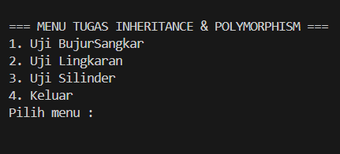
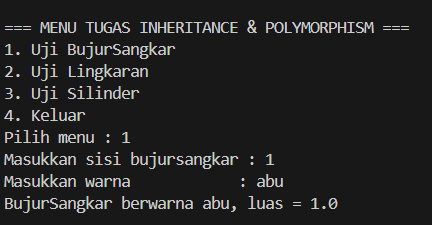
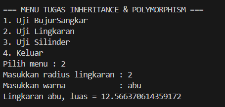
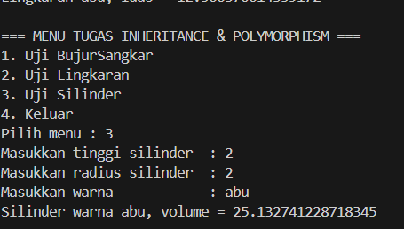
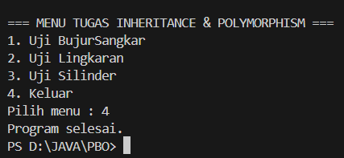

# Tugas Inheritance & Polymorphism - PBO

Repositori ini berisi implementasi konsep Object-Oriented Programming (OOP) dalam bahasa Java, yang mencakup Encapsulation, Inheritance, dan Polymorphism pada studi kasus bangun ruang dan bidang.

## Penjelasan Konsep OOP pada Kode:
1. **Encapsulation (Penyembunyian Data):**
   - Variabel instance seperti `warna` (di kelas `Bentuk`), `sisi` (di `BujurSangkar`), `radius` (di `Lingkaran`), dan `tinggi` (di `Silinder`) dideklarasikan menggunakan modifier akses (private/protected/default).
   - Diakses dan dimodifikasi secara aman melalui metode getter (`get...()`) dan setter (`set...()`).

2. **Inheritance (Pewarisan):**
   - **`Bentuk`** bertindak sebagai kelas induk (*parent class*).
   - **`BujurSangkar`** dan **`Lingkaran`** mewarisi sifat dari kelas `Bentuk` (`extends Bentuk`).
   - **`Silinder`** mewarisi sifat dari kelas `Lingkaran` (`extends Lingkaran`), membentuk rantai hierarki pewarisan bertingkat.
   - Penggunaan keyword `super(...)` untuk memanggil constructor dari kelas induk.

3. **Polymorphism (Polimorfisme):**
   - Menggunakan method overriding pada metode `printInfo()` di tiap kelas turunan.
   - Pada `Main.java`, objek turunan ditampung dalam referensi tipe induk (contoh: `Bentuk bs = new BujurSangkar(...)`), sehingga pemanggilan method `printInfo()` akan menyesuaikan bentuk objek aslinya saat runtime.

## Screenshot Output Program

| Menu / Fitur | Screenshot Output |
| :--- | :--- |
| **1. Menu Utama** |  |
| **2. Bujur Sangkar** |  |
| **3. Lingkaran** |  |
| **4. Silinder** |  |
| **5. Keluar** |  |